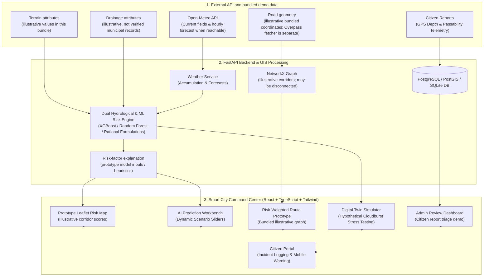

# AquaGuard AI
### AI-Powered Hyperlocal Flood Prediction & Smart City Early Warning System

> **Tagline:** *Predict Before It Floods. Protect Every Street.*  
> **Pilot City:** Jaipur, Rajasthan, India  
> **Geographical Bounding Box:** `[26.80°N, 75.70°E]` to `[27.02°N, 75.90°E]`

---

## Data quality and operational limitations

- The bundled ML training CSV is **synthetic**, generated by `ml_engine/data/generate_dataset.py`. Its metrics describe only a held-out split of generated examples, not observed Jaipur flood events or real-world prediction accuracy. The API does not report a calibrated confidence value.
- The bundled Jaipur road coordinates and hydrological attributes are illustrative demo data. Elevation, slope, drainage status/capacity, and historical incident counts have not been independently verified against authoritative municipal or survey records.
- Open-Meteo is an external weather API, not a local rain-gauge network. The offline fallback is simulated and marked as such.
- The route planner will not invent straight-line connectors between disconnected road components. If the bundled graph does not contain a continuous path, it returns `NO_ROUTE_FOUND`.
- Citizen-submitted reports are unverified until reviewed. Demo alerts are explicitly marked as demo data. This prototype is not an emergency dispatch, traffic-control, or road-closure authority.

## 1. Problem Statement & Urban Context

Urban flooding and monsoon waterlogging can affect commuter safety, economic activity, and public infrastructure. Regional rainfall forecasts generally do not provide verified street-level road passability. This project explores a prototype workflow for combining weather, road, terrain, drainage, and citizen-report information; the bundled sample data does not establish the flood history or current condition of any named Jaipur road.

**AquaGuard AI** is a prototype for exploring how weather, road-network, terrain, drainage, and citizen-report data could support a hyperlocal early-warning workflow. In this bundled version, Open-Meteo is the only external data feed; road and hydrological attributes are illustrative and require authoritative verification before operational use.

---

## 2. Proposed Solution & Core Innovation

AquaGuard AI demonstrates a configurable risk score for bundled road-corridor examples and displays prototype advisories:

1. **Heuristic risk baseline:** Uses configurable rainfall and terrain/drainage attributes. Bundled terrain and drainage attributes are illustrative, not verified DEM or municipal measurements.
2. **Dual AI/ML Prediction Engine:** Combines an empirical hydrological baseline with Random Forest / XGBoost models trained on generated synthetic scenarios. Reported benchmark metrics apply only to a held-out split of that synthetic dataset and are **not real-world flood prediction accuracy**.
3. **Risk-factor explanations:** Shows the factors used by the prototype risk engine. These are model inputs/heuristics, not verified causal explanations of actual flooding.
4. **Risk-weighted route prototype:** NetworkX routing over the bundled illustrative road graph. It is not an authoritative navigation or road-closure service.
5. **Digital Twin Scenario Simulator:** Stress-tests the city under hypothetical 20mm, 40mm, 60mm, or 100mm cloudburst events with varying drainage siltation.
6. **Citizen reporting workflow:** Allows residents to submit water-depth and passability reports. Reports remain unverified until reviewed; no real municipal dispatch integration is included.

---

## 3. System Architecture



---

## 4. Technology Stack

| Layer | Technologies Used | Purpose |
|---|---|---|
| **Frontend** | React 18, TypeScript, Vite, Tailwind CSS, Lucide React, React Leaflet, Leaflet.js, Recharts, Axios, React Router | Modern, responsive dark-navy Smart City Command Center & Citizen Portal |
| **Backend** | Python 3.11, FastAPI, Pydantic V2, SQLAlchemy, Uvicorn, HTTPX | REST API and OpenAPI documentation |
| **Database** | SQLite for local development; PostgreSQL supported with psycopg v3 | Relational storage. Coordinates are currently stored as JSON; PostGIS geometry columns and spatial indexes are not implemented. |
| **Machine Learning** | XGBoost, Scikit-Learn 1.8.0, Pandas, NumPy, SHAP, Joblib | Synthetic-scenario classifier training and prototype risk scoring |
| **GIS & Routing** | NetworkX, bundled coordinate data, standalone Overpass fetcher | Prototype graph routing; verified DEM/drainage ingestion is not implemented. |
| **Quality Assurance** | Pytest, FastAPI TestClient, TypeScript syntax transpilation | Backend tests pass; full frontend type-check / production build still needs verification |
| **Deployment** | Docker Compose, multi-stage Dockerfiles, Nginx, Vercel / Render setup instructions | Deployment configuration is provided; a live deployment has not been performed by this audit |

---

## 5. Pilot City Profile: Jaipur, Rajasthan, India

AquaGuard AI is anchored in real-world geography for the city of Jaipur:

- **Bundled demo elevation range:** 374m to 530m in illustrative sample attributes; these are not verified survey/DEM values.
- **Illustrative road corridors (24 segments, not a verified municipal road inventory):**
  1. *Sodala Underpass & Elevated Corridor* (Depression: 388m, Frequent Submersion)
  2. *Tonk Road (Dravyavati River Crossing)* (381m, Basin Outfall)
  3. *JLN Marg (World Trade Park & Malviya Underpass)* (395m)
  4. *Amer Road (Jal Mahal Promenade & Culvert)* (390m, Hill Runoff)
  5. *Sikar Road (Dadi Ka Phatak Underpass)* (391m, Severe Siltation)
  6. *MI Road & Ajmeri Gate* (432m, Walled City Ridge)
  7. *Badi Chaupar & Johari Bazaar* (434m)
  8. *Ajmer Road & Sodala Flyover Link* (398m)
  9. *Mansarovar Shipra Path (Near Dravyavati Outfall)* (379m)
  10. *Civil Lines / Hawa Sadak (Secretariat Corridor)* (418m)
  11. *Gopalpura Bypass (Triveni Nagar Underpass)* (382m)
  12. *C-Scheme (Statue Circle)* (427m)
  13. *Jhotwara Road (Niwaru Crossing)* (389m)
  14. *Sanganer Bridge & Airport Peripheral Road* (374m, Lowest Basin)
  15. *Nahargarh Fort Hill Descent Road* (530m, Steep Gradient)
  *(and 9 additional arterial connecting corridors across Jaipur)*.
- **Critical Drainage Networks:** Dravyavati River Main Channel (Amanishah Nallah - 47.5 km), Gopalpura Canal, and Jal Mahal Catchment Weir.

---

## 6. AI/ML Engine & Benchmark Evaluation

### Predictors Implemented
1. **Approach A: Baseline Hydrological Engine**  
   Implements physical Rational Runoff formulations ($Q = C \times I \times A$) balancing rainfall intensity, 3-hour antecedent ground saturation, topographic elevation depression, terrain slope acceleration, and stormwater canal distance.
2. **Approach B: Supervised Machine Learning**  
   Trained on 2,880 generated synthetic scenario records using 12 demonstration features (not observed hydrological records):
   - `rainfall_intensity_mm_h`, `rainfall_cum_3h_mm`, `rainfall_cum_24h_mm`, `forecast_1h_mm`
   - `elevation_m`, `slope_deg`, `distance_to_drain_m`, `drainage_capacity_m3s`
   - `drainage_status_val`, `underpass`, `historical_incidents_count`, `soil_runoff_coeff`

### Synthetic-data benchmark (out-of-sample split: 720 synthetic samples)

> **Important:** The following scores are only synthetic benchmark results. The generator creates labels from programmed hydrological rules. These scores do not establish real-world prediction accuracy, and the synthetic data must not be described as measured Jaipur flood incidents.

| Model | Accuracy | Precision | Recall | F1-Score | ROC-AUC | PR-AUC |
|---|---|---|---|---|---|---|
| **Logistic Regression (Linear Baseline)** | 97.78% | 0.9565 | 0.9798 | 0.9680 | 0.9982 | 0.9968 |
| **Random Forest (Ensemble)** | **98.75%** | **0.9798** | **0.9838** | **0.9818** | 0.9938 | 0.9935 |
| **XGBoost (Gradient Boosted Trees)** | 98.33% | 0.9719 | 0.9798 | 0.9758 | **0.9990** | **0.9981** |

### Confusion Matrix (synthetic Random Forest test split)
- **True Negatives (TN):** 468
- **False Positives (FP):** 5
- **False Negatives (FN):** 4
- **True Positives (TP):** 243

These are synthetic-label classification counts only, not observed road-condition outcomes.

### Global SHAP Feature Importance
1. `rainfall_cum_3h_mm` (2.4406)
2. `underpass` (1.9258)
3. `rainfall_cum_24h_mm` (1.2855)
4. `rainfall_intensity_mm_h` (1.0457)
5. `elevation_m` (1.0053)
6. `forecast_1h_mm` (0.6488)

---

## 7. Data Provenance & Ethical Transparency

| Data Domain | Source | Real vs. Synthetic | Notes & Ethical Disclosure |
|---|---|---|---|
| **Road Geometries & Corridors** | Bundled illustrative pilot coordinates | **Unverified demo attributes** | Not a verified live OSM extract. Replace with a timestamped, licensed OSM/municipal road dataset before operational use. |
| **Elevation & Terrain Slope** | Bundled illustrative values | **Unverified demo attributes** | Replace with values extracted from a documented DEM and validate against authoritative sources before operational use. |
| **Precipitation Telemetry** | Open-Meteo API | **External API fields / forecast** | Current and forecast fields for the pilot coordinate when reachable; offline fallback is simulated and clearly marked. Not a local rain-gauge network. |
| **Municipal Drainage Channels** | Illustrative hand-entered attributes | **Unverified demo attributes** | Drainage status/capacity and proximity values are not confirmed municipal records. |
| **Training labels** | Synthetic hydrological rule generator | **Synthetic** | 2,880 generated scenarios. No verified historical flood incident labels are included in the training CSV. Citizen reports are not automatically model ground truth. |

---

## 8. Database Architecture (12 Tables)

1. `users`: Authentication and role-based access (`citizen` vs. `admin`).
2. `road_segments`: Monitored street-level road segments with GPS coordinates, elevation, slope, drain distance, and underpass status.
3. `rainfall_records`: Ingested Open-Meteo precipitation observations and forecasts.
4. `elevation_records`: Detailed DEM elevation profiles and topographic flow accumulations.
5. `drainage_features`: Stormwater canals, outfall weirs, and Dravyavati river channels.
6. `flood_incidents`: Documented historical inundation records with depth and duration.
7. `citizen_reports`: Crowdsourced incident submissions (water depth, passability, photos).
8. `predictions`: Logged AI model predictions with calibrated risk scores and confidence.
9. `alerts`: Active emergency alerts and citizen road advisories.
10. `emergency_services`: SDRF disaster response centers, fire rescue, and trauma hospitals.
11. `monitored_locations`: User-saved commute routes and threshold preferences.
12. `model_metadata`: Model versioning, hyperparameter history, and benchmark metrics.

---

## 9. REST API Reference

| Method | Endpoint | Description |
|---|---|---|
| `GET` | `/api/health` | Health check verifying backend, DB, and ML model status |
| `GET` | `/api/cities` | List of supported pilot cities (Jaipur default) |
| `GET` | `/api/weather/current` | Open-Meteo current weather fields when reachable; otherwise labelled demo fallback |
| `GET` | `/api/weather/forecast` | 12-hour precipitation forecast and hyetograph data |
| `GET` | `/api/map/road-segments` | Street-level road network geometries and elevation |
| `GET` | `/api/flood/risk-map` | Prototype risk scores for bundled illustrative corridors, using Open-Meteo weather when available |
| `GET` | `/api/flood/segment/{id}` | Detailed hydrological inspection and SHAP factors for a road |
| `POST` | `/api/flood/predict` | Custom AI prediction workbench with interactive sliders |
| `POST` | `/api/flood/simulate` | Digital Twin rainfall scenario simulator (20, 40, 60, 100mm) |
| `POST` | `/api/reports` | Submit citizen waterlogging report with GPS coordinates |
| `GET` | `/api/reports` | Retrieve citizen report feed with status filter |
| `PATCH` | `/api/reports/{id}/status`| Admin endpoint to verify, reject, or resolve citizen reports |
| `POST` | `/api/routes/safe` | Prototype comparison of shortest and lower-relative-score paths on the illustrative graph |
| `GET` | `/api/alerts` | Active citizen early warnings and road closures |
| `GET` | `/api/emergency-services` | Jaipur SDRF centers, fire stations, and trauma units |
| `GET` | `/api/analytics/overview` | Prototype dashboard, score distribution, and illustrative hotspot attributes |
| `GET` | `/api/admin/incidents` | Admin review queue for citizen reports (not municipal dispatch) |
| `GET` | `/api/ml/metrics` | Model benchmark comparisons and SHAP feature importance |

---

## 10. Local Setup & Execution Guide (Windows)

### Prerequisites
- Python 3.11+ (Python 3.14 compatible)
- Node.js LTS (v20+ or v26+) & npm
- Git

### Quick Setup Commands (PowerShell)

```powershell
# 1. Clone or navigate to the repository
cd C:\Users\dell\.gemini\antigravity\scratch\AquaGuard-AI

# 2. Update PATH to include Node.js (if newly installed)
$env:PATH = "C:\Program Files\nodejs;" + [System.Environment]::GetEnvironmentVariable("PATH", "Machine") + ";" + [System.Environment]::GetEnvironmentVariable("PATH", "User")

# 3. Create and activate Python Virtual Environment
python -m venv venv
.\venv\Scripts\pip.exe install -r backend\requirements.txt

# 4. Generate Dataset & Train ML Models (Takes ~10 seconds)
.\venv\Scripts\python.exe ml_engine\data\generate_dataset.py
.\venv\Scripts\python.exe ml_engine\training\train_models.py

# 5. Initialize & Seed Database
.\venv\Scripts\python.exe backend\app\database\init_db.py

# 6. Install Frontend Dependencies
cd frontend
& "C:\Program Files\nodejs\npm.cmd" install
cd ..
```

### Running Backend & Frontend

#### Terminal 1: Run FastAPI Backend
```powershell
cd AquaGuard-AI
.\venv\Scripts\uvicorn.exe backend.app.main:app --host 127.0.0.1 --port 8000 --reload
```
*Backend runs on `http://127.0.0.1:8000`. Swagger API docs available at `http://127.0.0.1:8000/docs`.*

#### Terminal 2: Run React Vite Frontend
```powershell
cd AquaGuard-AI\frontend
npm run dev
```
*Frontend runs on `http://localhost:5173`.*

---

## 11. Running Automated Tests

Run the backend integration test suite with Pytest:
```powershell
cd AquaGuard-AI
.\venv\Scripts\python.exe -m pytest backend\tests\test_api.py -v
```
*Backend suite: 17 automated tests (run the command above to see the current result).*

Run Frontend production build verification:
```powershell
cd AquaGuard-AI\frontend
npm run build
```
*A frontend build result must be generated on the target machine; no verified build result is included in this source archive.*

---

## 12. Docker Compose Setup (PostgreSQL + PostGIS)

To run the local container stack with PostgreSQL (the image includes PostGIS, but this version does not yet use PostGIS geometry columns):
```bash
Copy `.env.example` to `.env`, set strong values for `SECRET_KEY`, `ADMIN_API_KEY`, and `POSTGRES_PASSWORD`, then run:

```bash
docker compose up --build
```
```
- Frontend: `http://localhost:5173`
- Backend: `http://localhost:8000`
- PostgreSQL/PostGIS: `localhost:5432`

---

## 13. Hackathon Live Demonstration Walkthrough

Follow this 7-step presentation guide for an end-to-end live demonstration:

1. **DEMO 1 — Overview & Jaipur Prototype Map:**
   - Open `http://localhost:5173`.
   - View the prototype KPI cards and check the weather source label. If the API is unavailable, the application uses a clearly labelled simulated fallback.
   - Navigate to **Live Map** (`/map`) and observe the color-coded illustrative road-segment scores (Green: Low, Yellow: Moderate, Orange: High, Red: Critical).

2. **DEMO 2 — Street Inspection & Explainable AI:**
   - Click on **Sodala Underpass & Elevated Corridor** on the map.
   - Inspect the drawer: Elevation (388.2m), terrain slope, drain proximity (120m), and SHAP contributing factors (*Enclosed underpass geometry: +16 pts, Basin depression: +14 pts*).

3. **DEMO 3 — Digital Twin Monsoon Simulator:**
   - Navigate to **Digital Twin** (`/simulator`).
   - Select **Scenario 3 (60 mm Severe Monsoon Storm)** or **Scenario 4 (100 mm Cloudburst)**.
   - Watch the network dynamically recalculate and display which corridors flip into High and Critical inundation tiers.

4. **DEMO 4 — Crowdsourced Citizen Reporting:**
   - Open **Citizen Portal** (`/citizen`).
   - Click **Auto-Locate** or specify *"Purani Chungi Junction"*.
   - Select Water Depth: *"Waist-deep"*, Passability: *"Impassable"*, and submit the report.

5. **DEMO 5 — Authority Command Center & Incident Triage:**
   - Navigate to **Command Center** (`/admin`).
   - See the newly submitted citizen report at the top of the P1 Emergency Triage table.
   - Enter the server-configured `ADMIN_API_KEY` when prompted, then update a test report. Do not enter invented dispatch notes or treat demo reports as real incidents.

6. **DEMO 6 — Risk-Weighted Route Prototype:**
   - Navigate to **Safe Routes** (`/routes`). Treat the result as a graph demonstration, not a verified safe navigation route.
   - Select start and destination coordinates that are connected by the currently bundled graph.
   - If no continuous path exists, the planner now returns `NO_ROUTE_FOUND` rather than inventing a straight-line connector. The bundled graph is illustrative and may not provide a route across Jaipur.

7. **DEMO 7 — Historical Analytics & Model Benchmarks:**
   - Navigate to **Analytics** (`/analytics`).
   - Review the Confusion Matrix and benchmark comparison (Random Forest vs XGBoost vs Logistic Regression).
   - Treat bundled hotspot rankings as illustrative examples unless replaced with verified historical incident records.

---

## 14. Deployment Guidelines

**Admin API access:** Set a strong `ADMIN_API_KEY` on the backend. The control-room UI asks an authorized operator for this key and keeps it in the current browser tab session only. Do not put this key in `VITE_*` build variables. `VITE_API_URL` may be set to the backend origin (for example `https://your-backend.onrender.com`) or its `/api` URL; the frontend normalizes either form.

### Frontend on Vercel
1. Link GitHub repository root with framework preset **Vite**.
2. Root directory: `frontend`.
3. Build command: `npm run build`. Output directory: `dist`.
4. Environment variable: `VITE_API_URL=https://your-backend.onrender.com` (the frontend appends `/api` automatically; you may also supply the full `/api` URL).

### Backend on Render
1. Create a **Web Service** pointing to repository root.
2. Build command: `pip install -r backend/requirements.txt`. The bundled prototype model artifacts are included; do not retrain automatically during deployment.
3. Start command: `uvicorn backend.app.main:app --host 0.0.0.0 --port $PORT`.
4. Add environment variables from `.env.example`.

### Database on Supabase
1. Create a PostgreSQL project (PostGIS is optional for this version; spatial geometry columns are not yet used).
2. In backend settings, set `DATABASE_URL=postgresql://postgres:[PASSWORD]@[HOST]:5432/postgres`. The backend normalizes this URL to the installed psycopg v3 driver. URL-encode special characters in the password.
3. Run `backend/app/database/init_db.py` to seed tables.

---

## 15. Limitations & Roadmap

- **Verified high-resolution elevation:** Integrate a documented DEM / municipal survey dataset and validate vertical accuracy before making street-level claims.
- **Verified incident and sensor labels:** Integrate municipal incident logs or field-validated water-depth sensors to train and evaluate real-world models.
- **Multilingual Support:** Citizen interface expansion to Hindi (`राजस्थान स्मार्ट सिटी - जलभराव चेतावनी`) for broader community accessibility.

---


