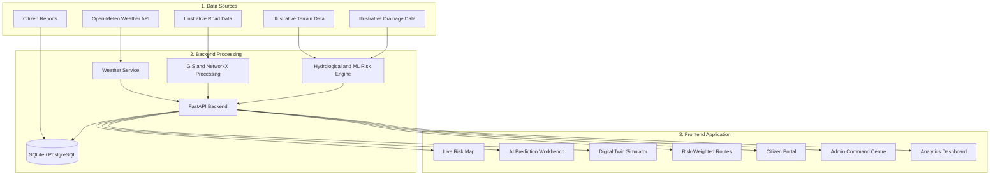

# 🌊 AquaGuard AI

### AI-Powered Hyperlocal Flood Prediction & Smart City Early Warning System

> **Tagline:** *Predict Before It Floods. Protect Every Street.*

🚀 **Live Demo:** https://aqua-guard-ai-two.vercel.app/

🔗 **Backend API:** https://aquaguard-ai-3rvn.onrender.com

📘 **API Documentation:** https://aquaguard-ai-3rvn.onrender.com/docs

**Pilot City:** Jaipur, Rajasthan, India  
**Project Domain:** Artificial Intelligence | Machine Learning | GIS | Smart City | Disaster Management

---

## 1. Project Overview

AquaGuard AI is an AI-powered prototype designed to explore hyperlocal flood and urban waterlogging risk assessment.

The platform combines weather information, illustrative road-network data, terrain and drainage attributes, machine learning models, and citizen-submitted reports to demonstrate how a smart-city early-warning workflow could operate.

Unlike general weather applications, AquaGuard AI focuses on demonstrating risk assessment at individual road-corridor level through an interactive map, rainfall scenario simulations, risk explanations, and prototype route analysis.

The project is currently configured around Jaipur, Rajasthan, India.

### Key Highlights

- Interactive Jaipur waterlogging risk map.
- AI/ML-based prototype risk assessment.
- Rainfall and cloudburst scenario simulation.
- Risk-factor explanations.
- Risk-weighted route planning prototype.
- Citizen waterlogging reporting portal.
- Admin Command Centre and incident review workflow.
- Weather integration using Open-Meteo.
- Analytics dashboard and synthetic ML benchmark comparison.

> **Project Status:** Deployed prototype. The application is available through Vercel and Render. Its bundled road, terrain, and drainage attributes are illustrative and are not verified municipal datasets.

---

## 2. Problem Statement & Urban Context

Urban flooding and monsoon-related waterlogging can affect commuter safety, economic activity, transportation, and public infrastructure.

Traditional weather forecasts generally provide area-level rainfall information rather than verified street-level road-passability information.

AquaGuard AI explores a technology-driven approach to this challenge by combining:

- Rainfall intensity and forecast information.
- Road-network characteristics.
- Terrain and elevation attributes.
- Drainage-related parameters.
- Citizen-submitted waterlogging reports.
- Machine learning-based risk assessment.

The objective is to demonstrate how these data sources could support a hyperlocal early-warning and decision-support system for urban environments.

---

## 3. Proposed Solution & Core Innovation

AquaGuard AI provides an integrated prototype with the following modules:

### 3.1 Hyperlocal Flood Risk Mapping
Displays illustrative Jaipur road corridors with colour-coded prototype risk levels:

- Green – Low Risk
- Yellow – Moderate Risk
- Orange – High Risk
- Red – Critical Risk

### 3.2 Dual Risk Assessment Engine
Combines a heuristic hydrological baseline with supervised machine learning models to demonstrate rainfall-related risk classification.

### 3.3 Explainable Risk Factors
Displays the input factors contributing to the prototype risk score, helping users understand how rainfall, elevation, underpass status, and other parameters influence the assessment.

### 3.4 Risk-Weighted Route Planning
Uses NetworkX to demonstrate route comparison based on relative risk scores over the bundled road graph.

### 3.5 Digital Twin Scenario Simulator
Allows users to explore hypothetical rainfall scenarios of 20 mm, 40 mm, 60 mm, and 100 mm, along with different drainage-siltation conditions.

### 3.6 Citizen Reporting Portal
Allows citizens to submit waterlogging reports containing water-depth and road-passability information.

### 3.7 Smart City Command Centre
Provides an admin interface for reviewing, verifying, rejecting, and resolving submitted reports, subject to backend admin authorization.

---

## 4. System Architecture



### Architecture Explanation

- **Frontend:** Provides interactive maps, dashboards, simulation controls, and citizen-facing interfaces.
- **Backend:** Handles API requests, weather integration, risk calculations, report processing, and database operations.
- **ML Engine:** Demonstrates classification using synthetic training scenarios.
- **GIS and Routing:** Processes bundled road-network coordinates and performs graph-based route analysis.
- **Database:** Stores application records and supports local SQLite and PostgreSQL configurations.

---

## 5. Technology Stack

| Layer | Technologies | Purpose |
|---|---|---|
| Frontend | React 18, TypeScript, Vite | Interactive web application |
| UI Styling | Tailwind CSS, Lucide React | Responsive user interface |
| Maps | React Leaflet, Leaflet.js | Interactive risk mapping |
| Charts | Recharts | Analytics and visualizations |
| API Integration | Axios | Frontend-backend communication |
| Backend | Python, FastAPI, Pydantic | REST APIs and business logic |
| Database | SQLite, PostgreSQL | Application data storage |
| Machine Learning | Scikit-learn, XGBoost | Synthetic-scenario classification |
| Data Processing | Pandas, NumPy | Dataset processing |
| Model Utilities | Joblib, SHAP | Model persistence and feature analysis |
| GIS and Routing | NetworkX, Shapely, GeoPandas | Prototype spatial and graph processing |
| Weather | Open-Meteo API | External weather information |
| Testing | Pytest, FastAPI TestClient | Backend testing |
| Deployment | Vercel, Render | Frontend and backend hosting |

---

## 6. Pilot City: Jaipur, Rajasthan, India

AquaGuard AI uses Jaipur as its demonstration city.

**Geographical Bounding Box:**

`[26.80°N, 75.70°E]` to `[27.02°N, 75.90°E]`

### Illustrative Road Corridors

The bundled demonstration dataset contains 24 road-segment examples, including:

1. Sodala Underpass & Elevated Corridor
2. Tonk Road – Dravyavati River Crossing
3. JLN Marg – World Trade Park & Malviya Underpass
4. Amer Road – Jal Mahal Promenade & Culvert
5. Sikar Road – Dadi Ka Phatak Underpass
6. MI Road & Ajmeri Gate
7. Badi Chaupar & Johari Bazaar
8. Ajmer Road & Sodala Flyover Link
9. Mansarovar Shipra Path
10. Civil Lines / Hawa Sadak
11. Gopalpura Bypass – Triveni Nagar Underpass
12. C-Scheme – Statue Circle
13. Jhotwara Road – Niwaru Crossing
14. Sanganer Bridge & Airport Peripheral Road
15. Nahargarh Fort Hill Descent Road

The remaining bundled examples represent additional demonstration corridors.

**Important data limitation:** These coordinates and associated elevation, drainage, slope, and incident attributes are illustrative. They are not a verified Jaipur municipal road inventory or independently validated hydrological survey.

---

## 7. AI/ML Engine & Benchmark Evaluation

AquaGuard AI demonstrates two complementary approaches to prototype flood-risk assessment.

### 7.1 Approach A – Heuristic Hydrological Baseline

The baseline uses a configurable combination of rainfall, terrain, and drainage-related parameters.

The Rational Method provides a conceptual hydrological reference:

\[
Q = C \times I \times A
\]

Where:

- Q = Runoff rate
- C = Runoff coefficient
- I = Rainfall intensity
- A = Catchment area

The prototype also considers parameters such as antecedent rainfall, elevation depression, terrain slope, and drainage-related attributes.

This is a simplified prototype formulation, not a calibrated hydrological model of Jaipur.

### 7.2 Approach B – Supervised Machine Learning

The ML engine uses generated synthetic scenarios to demonstrate classification.

**Dataset Details:**

- Total generated records: 2,880
- Synthetic test samples: 720
- Demonstration features: 12
- Models: Logistic Regression, Random Forest, XGBoost

**Input Features:**

- `rainfall_intensity_mm_h`
- `rainfall_cum_3h_mm`
- `rainfall_cum_24h_mm`
- `forecast_1h_mm`
- `elevation_m`
- `slope_deg`
- `distance_to_drain_m`
- `drainage_capacity_m3s`
- `drainage_status_val`
- `underpass`
- `historical_incidents_count`
- `soil_runoff_coeff`

### 7.3 Synthetic Dataset Benchmark

| Model | Accuracy | Precision | Recall | F1-Score | ROC-AUC | PR-AUC |
|---|---:|---:|---:|---:|---:|---:|
| Logistic Regression | 97.78% | 0.9565 | 0.9798 | 0.9680 | 0.9982 | 0.9968 |
| Random Forest | **98.75%** | **0.9798** | **0.9838** | **0.9818** | 0.9938 | 0.9935 |
| XGBoost | 98.33% | 0.9719 | 0.9798 | 0.9758 | **0.9990** | **0.9981** |

> **Critical evaluation note:** These metrics describe only a held-out split of generated synthetic examples. The generator creates labels using programmed rules. They do not demonstrate real-world flood prediction accuracy in Jaipur.

### 7.4 Random Forest Confusion Matrix

| Metric | Count |
|---|---:|
| True Negatives | 468 |
| False Positives | 5 |
| False Negatives | 4 |
| True Positives | 243 |

These counts refer to synthetic test labels, not observed road-condition outcomes.

### 7.5 Feature Importance

The bundled model analysis highlights the following features:

1. `rainfall_cum_3h_mm`
2. `underpass`
3. `rainfall_cum_24h_mm`
4. `rainfall_intensity_mm_h`
5. `elevation_m`
6. `forecast_1h_mm`

These are model-importance indicators, not proof of causal relationships with actual flooding.

---

## 8. Data Sources & Transparency

| Data Domain | Source | Data Status |
|---|---|---|
| Weather | Open-Meteo API | External weather API fields and forecast |
| Road Coordinates | Bundled project data | Illustrative and unverified |
| Elevation | Bundled project attributes | Illustrative and unverified |
| Terrain Slope | Bundled project attributes | Illustrative and unverified |
| Drainage | Bundled project attributes | Illustrative and unverified |
| ML Training Data | Synthetic dataset generator | Synthetic |
| Citizen Reports | Application submissions | Unverified until reviewed |
| Offline Weather Fallback | Application fallback | Simulated and labelled |

### Important Operational Limitations

- The bundled ML dataset is synthetic; its benchmark metrics must not be presented as real-world prediction accuracy.
- The application does not provide a calibrated probability or confidence value for actual flooding.
- Bundled road coordinates and hydrological attributes are illustrative.
- Open-Meteo is an external weather source, not a local rain-gauge network.
- Offline weather fallback values are simulated and should not be interpreted as live observations.
- Citizen reports remain unverified until reviewed.
- The route planner does not invent connectors between disconnected road components. It returns `NO_ROUTE_FOUND` when no continuous path is available.
- The application is a prototype decision-support demonstration, not an emergency dispatch, traffic-control, or road-closure authority.

---

## 9. Database Architecture

The project documentation describes the following planned and application data entities:

1. `users` – User accounts and roles.
2. `road_segments` – Road-segment attributes and coordinates.
3. `rainfall_records` – Weather and precipitation records.
4. `elevation_records` – Terrain and elevation information.
5. `drainage_features` – Drainage-related attributes.
6. `flood_incidents` – Historical incident records.
7. `citizen_reports` – User-submitted waterlogging reports.
8. `predictions` – Prototype prediction records.
9. `alerts` – Application alerts and advisories.
10. `emergency_services` – Emergency-service reference data.
11. `monitored_locations` – Saved monitoring locations.
12. `model_metadata` – Model and benchmark metadata.

**Implementation note:** The list describes the documented data architecture. Not every entity should be assumed to have a fully implemented production workflow. SQLite is used for local development, with PostgreSQL support. PostGIS geometry columns and spatial indexes are not implemented in this version.

---

## 10. REST API Reference

The backend exposes REST endpoints through FastAPI.

| Method | Endpoint | Description |
|---|---|---|
| GET | `/api/health` | Backend health check |
| GET | `/api/cities` | Supported pilot cities |
| GET | `/api/weather/current` | Current weather information |
| GET | `/api/weather/forecast` | Hourly precipitation forecast |
| GET | `/api/map/road-segments` | Bundled road-segment data |
| GET | `/api/flood/risk-map` | Prototype risk-map scores |
| GET | `/api/flood/segment/{id}` | Road-segment risk details |
| POST | `/api/flood/predict` | Custom prediction workbench |
| POST | `/api/flood/simulate` | Hypothetical rainfall simulation |
| POST | `/api/reports` | Submit a citizen report |
| GET | `/api/reports` | Retrieve citizen reports |
| PATCH | `/api/reports/{id}/status` | Admin report-status update |
| POST | `/api/routes/safe` | Prototype route comparison |
| GET | `/api/alerts` | Application alerts |
| GET | `/api/emergency-services` | Emergency-service reference data |
| GET | `/api/analytics/overview` | Analytics dashboard data |
| GET | `/api/admin/incidents` | Admin review queue |
| GET | `/api/ml/metrics` | Synthetic ML benchmark metrics |

### API Documentation

Interactive API documentation is available at:

https://aquaguard-ai-3rvn.onrender.com/docs

---

## 11. Local Installation & Setup

### Prerequisites

- Python 3.11
- Node.js and npm
- Git
- MySQL is not required for the default SQLite configuration.

### Step 1 – Clone the Repository

```bash
git clone YOUR_GITHUB_REPOSITORY_URL
cd AquaGuard-AI
```

Replace `YOUR_GITHUB_REPOSITORY_URL` with the actual GitHub repository URL.

### Step 2 – Create a Python Virtual Environment

```powershell
py -3.11 -m venv .venv
```

Activate it:

```powershell
Set-ExecutionPolicy -Scope Process -ExecutionPolicy Bypass
.\.venv\Scripts\Activate.ps1
```

### Step 3 – Install Backend Dependencies

```powershell
pip install -r backend\requirements.txt
```

### Step 4 – Generate the Synthetic Dataset and Train Models

Run these commands only when you need to regenerate the dataset or retrain the models:

```powershell
python ml_engine\data\generate_dataset.py
python ml_engine\training\train_models.py
```

The generated training data is synthetic.

### Step 5 – Initialize the Database

```powershell
python backend\app\database\init_db.py
```

### Step 6 – Start the Backend

```powershell
python -m uvicorn backend.app.main:app --reload --host 127.0.0.1 --port 8000
```

Backend:

`http://127.0.0.1:8000`

API Documentation:

`http://127.0.0.1:8000/docs`

### Step 7 – Install Frontend Dependencies

Open a second terminal:

```powershell
cd frontend
npm install
```

### Step 8 – Start the Frontend

```powershell
npm run dev
```

Frontend:

`http://localhost:5173`

Keep both backend and frontend terminals running while using the local application.

---

## 12. Running Automated Tests

### Backend Tests

From the repository root:

```powershell
python -m pytest backend\tests\test_api.py -v
```

The project test suite has previously been reported to pass 17 tests. Run the command above to verify the current checkout and its actual result.

### Frontend Production Build

```powershell
cd frontend
npm run build
```

A successful build should generate the production output in the `dist` directory.

Do not treat a successful deployment or a locally working development server as proof that every production build check has passed.

---

## 13. Deployment Architecture

AquaGuard AI uses separate hosting services for its frontend and backend.

### Live Deployment Links

| Component | Platform | URL |
|---|---|---|
| Frontend | Vercel | https://aqua-guard-ai-two.vercel.app/ |
| Backend | Render | https://aquaguard-ai-3rvn.onrender.com |
| API Documentation | Render | https://aquaguard-ai-3rvn.onrender.com/docs |

### 13.1 Frontend Deployment – Vercel

The frontend is deployed on Vercel.

Configuration:

- Framework Preset: Vite
- Root Directory: `frontend` (for the repository structure where the frontend is inside this directory)
- Build Command: `npm run build`
- Output Directory: `dist`

Environment variable:

| Key | Value |
|---|---|
| `VITE_API_URL` | `https://aquaguard-ai-3rvn.onrender.com` |

The frontend uses this variable to communicate with the backend API.

### 13.2 Backend Deployment – Render

The FastAPI backend is deployed as a Render Web Service.

Configuration:

**Build Command:**

```bash
pip install -r backend/requirements.txt
```

**Start Command:**

```bash
python -m uvicorn backend.app.main:app --host 0.0.0.0 --port $PORT
```

Backend URL:

`https://aquaguard-ai-3rvn.onrender.com`

### 13.3 Backend Environment Variables

Configure the required environment variables in Render.

| Variable | Purpose |
|---|---|
| `ADMIN_API_KEY` | Protects admin-only operations |
| `SECRET_KEY` | Application security configuration |
| `CORS_ORIGINS` | Permitted frontend origins |
| `DATABASE_URL` | Optional PostgreSQL connection |

Example CORS value for the current frontend:

```json
["https://aqua-guard-ai-two.vercel.app"]
```

Use strong private values for secret variables. Never publish `ADMIN_API_KEY`, `SECRET_KEY`, database passwords, or other credentials in GitHub or README files.

**Admin access:** The Command Centre requires the server-configured admin key. The key must remain on the backend and must never be exposed through a `VITE_*` environment variable.

---

## 14. Hackathon Live Demonstration Walkthrough

The following sequence can be used to demonstrate the deployed application.

### Demo 1 – Overview and Live Map

Open:

https://aqua-guard-ai-two.vercel.app/

- Introduce AquaGuard AI and its objective.
- Show the dashboard and Jaipur pilot-city interface.
- Open the Live Map.
- Explain the colour-coded prototype risk levels.
- Identify whether the displayed weather information is live API data or simulated fallback data.

### Demo 2 – Road Inspection and Explainable AI

- Select a road segment from the map.
- Show its available rainfall, elevation, slope, and drainage-related attributes.
- Explain which inputs contribute to the prototype risk score.
- Clarify that bundled terrain and drainage values are illustrative.

### Demo 3 – Digital Twin Rainfall Simulator

- Open the Digital Twin / Simulator module.
- Select a hypothetical rainfall scenario such as 60 mm or 100 mm.
- Demonstrate how the application recalculates prototype risk levels.
- Explain how changing drainage-siltation assumptions affects the simulation.

### Demo 4 – Citizen Reporting

- Open the Citizen Portal.
- Submit a demonstration waterlogging report.
- Select the water-depth and road-passability options.
- Show the submitted report in the application.

Use clearly identified demonstration reports rather than presenting invented incidents as real events.

### Demo 5 – Command Centre and Admin Review

- Open the Command Centre / Control Room.
- Enter the server-configured `ADMIN_API_KEY`.
- Show the citizen report review workflow.
- Demonstrate the available report-status actions.

Do not expose the admin key during the presentation or place it in screenshots, slides, or public documentation.

### Demo 6 – Risk-Weighted Route Prototype

- Open Safe Routes.
- Select connected start and destination points.
- Compare the available route results.
- Explain how relative risk scores influence the prototype route comparison.

The result is not a guaranteed safe-navigation route. If the graph has no continuous path, the application returns `NO_ROUTE_FOUND`.

### Demo 7 – Analytics and ML Benchmarks

- Open the Analytics dashboard.
- Show model comparisons and available charts.
- Explain the difference between synthetic benchmark performance and real-world flood prediction accuracy.
- Discuss the future requirement for verified historical flood-event data.

---

## 15. Limitations & Future Roadmap

AquaGuard AI is a working prototype that demonstrates a possible hyperlocal flood-risk decision-support workflow. Further development is needed before it can be used operationally.

### Current Limitations

- Bundled road-network data is illustrative.
- Elevation and drainage attributes are not independently verified.
- The ML training dataset is synthetic.
- No verified historical Jaipur flood-event dataset is included.
- Weather information depends on external API availability.
- The bundled road graph may not contain continuous routes across the entire city.
- The system is not integrated with official municipal emergency-response services.
- The application does not provide guaranteed road-safety or emergency alerts.

### Future Enhancements

1. **Verified GIS Integration:** Integrate authoritative OpenStreetMap road extracts and validated municipal road data.
2. **DEM-Based Terrain Analysis:** Use documented Digital Elevation Models for elevation, slope, and flow-accumulation analysis.
3. **Real Flood Incident Dataset:** Train and evaluate models using verified historical waterlogging and flood-event records.
4. **IoT Rainfall and Water-Level Sensors:** Integrate real-time local sensor data.
5. **Advanced Model Evaluation:** Perform spatial and temporal validation using field-verified data.
6. **Multilingual Interface:** Add Hindi and regional-language support for wider accessibility.
7. **Official Alert Integration:** Explore authorized integration with municipal and disaster-management systems.
8. **Mobile-Friendly Citizen Experience:** Improve reporting and accessibility for mobile users.

---

## 16. Project Impact & Vision

AquaGuard AI demonstrates how Artificial Intelligence, Machine Learning, GIS, and real-time weather information can be combined into a smart-city prototype for exploring urban waterlogging risk.

Its long-term vision is to support:

- Better awareness of rainfall-related urban risks.
- More informed route decisions.
- Citizen participation in reporting waterlogging.
- Data-driven urban planning research.
- Improved integration of weather, terrain, and infrastructure information.

The project is a step toward exploring technology-enabled urban resilience and smarter disaster preparedness.

---

## 17. Conclusion

AquaGuard AI brings together a modern web application, FastAPI backend, machine learning models, GIS-based mapping, rainfall simulation, and citizen reporting into one integrated prototype.

By demonstrating a hyperlocal approach to waterlogging risk assessment, the project explores how AI-powered decision-support systems could contribute to safer and more resilient urban environments.

> **AquaGuard AI – Predict Before It Floods. Protect Every Street.**

---

## 18. License & Project Information

This project was developed as a hackathon prototype.

Before redistributing the project, review the licenses of its dependencies, datasets, map tiles, and external services.

**Project Name:** AquaGuard AI  
**Pilot City:** Jaipur, Rajasthan, India  
**Frontend:** React + TypeScript + Vite  
**Backend:** Python + FastAPI  
**ML:** Scikit-learn + XGBoost  
**Deployment:** Vercel + Render

**Live Demo:** https://aqua-guard-ai-two.vercel.app/
